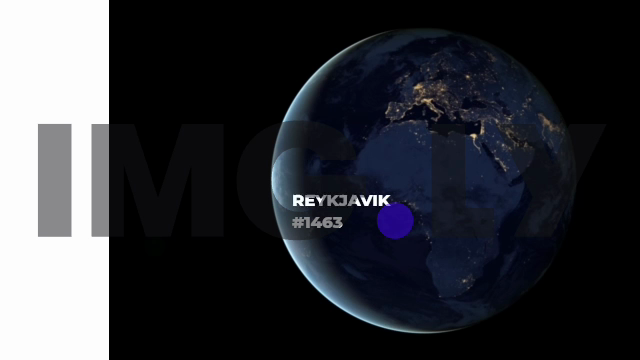

# cesdk-video-demo

Маленький демо-проєкт: експорт відео (MP4) із CE.SDK у Node.js, на базі
сцени з архіву `scene/scene-archive.zip`.

## Головне про експорт відео

| Пакет | Відео-експорт |
|---|---|
| `@cesdk/node` (WASM) | **ні** — тільки PNG/JPEG/PDF; для відео потрібен окремий CE.SDK Renderer |
| `@cesdk/node-native` (N-API) | **так** — `engine.block.exportVideo()`, H.264 + AAC у MP4 |

Нативний пакет (цей проєкт використовує `1.83.0`) кодує апаратно:
VideoToolbox/Metal на macOS, GStreamer/EGL на Linux. Вимоги: Node ≥ 22,
macOS 12+ (arm64/x64), Linux x64 (glibc ≥ 2.39) або Windows x64.
Старої назви `@imgly/cesdk-node` в npm немає — пакети живуть під скоупом `@cesdk`.

## Запуск

```sh
npm install
npm run inspect     # що є в сцені: сторінки, блоки, змінні
npm run export      # експорт усієї сцени в MP4
node src/export-video.mjs --duration 3           # швидка перевірка
node src/export-video.mjs --width 1280 --height 720
```

Результат пишеться одночасно на Робочий стіл і в `output/`.

## Ліцензія

Без ключа движок працює в режимі **For Evaluation Purposes Only** — відео
експортується повністю, але поверх кадру лягає водяний знак `IMG.LY`.
Щоб його прибрати:

```sh
CESDK_LICENSE="<ваш ключ>" npm run export
```

## Що робить `src/export-video.mjs`

1. `engine.scene.loadFromArchiveURL('file://…/scene-archive.zip', false, true)` —
   архів містить `scene.scene`, `fonts/` і `videos/`, тож зовнішні URL не потрібні.
   Третій аргумент `waitForResources=true` важливий: інакше експорт може
   стартувати до того, як відео та шрифти реально завантажились.
2. `engine.variable.setString('Location name', …)` — підставляє випадкове
   значення у текстовий блок `{{Location name}}`. Змінна оголошується самим
   фактом присвоєння; усі блоки, що на неї посилаються, оновлюються автоматично.
3. `engine.block.exportVideo(page, { mimeType: 'video/mp4', … })` — повертає
   `Blob`, який пишеться у файл.
4. `engine.dispose()` у `finally` — інакше процес не завершиться.

## Сцена з архіву

- сторінка 640×360, тривалість 30.53 с, білий фон;
- `//ly.img.ubq/track` → `graphic` з відео-заливкою, зміщений на x=109
  (біла смуга ліворуч — це сама сцена, не артефакт експорту);
- `text` зі змінною `{{Location name}}`;
- один `audio`-блок → в експорті з'являється доріжка AAC.

## Приклад кадру

Кадр із готового MP4 (8-ма секунда): текст відрендерено зі змінної,
водяний знак — наслідок роботи без ліцензійного ключа.


